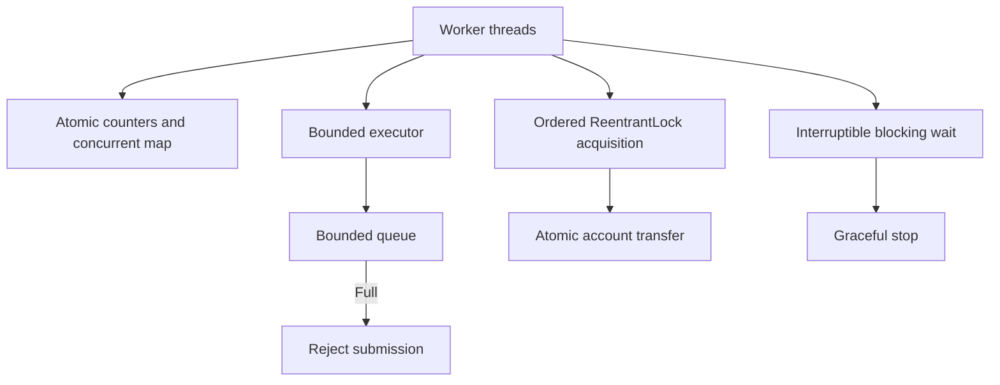

# Java Concurrency Lab

Runnable Java 17 examples for concurrency correctness, contention and coordination, with JUnit 5 tests and GitHub Actions CI.

## Run

```bash
mvn -B clean verify
```

## Topics and examples

- `SafeCounter`: `AtomicLong` versus `LongAdder` under contention; snapshots after joining workers.
- `ConcurrentWordCounter`: concurrent map and atomic per-key frequency updates.
- `VolatileStopFlag`: visibility and cooperative stop signal.
- `BoundedTaskExecutor`: bounded queue, fixed-size worker pool, rejection under saturation, orderly shutdown.
- `InterruptibleWorker`: interruptible blocking queue consumer and restoration of interrupt status.
- `LockProtectedTransfer`: consistent lock ordering prevents opposite-direction transfer deadlocks; account balances protected by locks.

## Design and tradeoffs



`volatile` guarantees visibility, not atomic read-modify-write. `AtomicLong` is suitable for exact atomic updates, whereas `LongAdder` reduces contention but its `sum()` is not an atomic snapshot during concurrent writes. Bounded queues make overload explicit rather than accumulating unbounded work. Interruption is cooperative: blocked operations should propagate or restore the interrupt signal. Lock ordering avoids circular wait, provided account identifiers are unique.

## Interview exercises

1. Explain why `volatile int count; count++` is not atomic.
2. Compare `AtomicLong` and `LongAdder` under contention.
3. Explain why unbounded executor queues can hide overload.
4. Explain how ordered lock acquisition avoids deadlocks.
5. Describe correct handling of `InterruptedException` and thread cancellation.

Tests assert deterministic invariants and use bounded waits; scheduling and throughput are environment-dependent. These examples teach core mechanisms rather than benchmark throughput.
