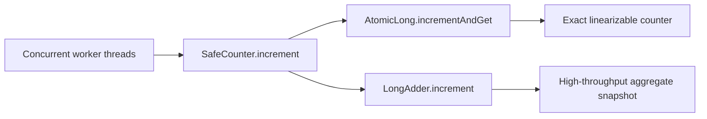

# Java Concurrency Lab

Runnable Java 17 examples for senior Java concurrency interviews.

## Run

```bash
mvn clean verify
```

## Implemented

- `SafeCounter` increments an `AtomicLong` and `LongAdder` under concurrent contention.
- JUnit 5 uses a start latch and multiple workers, then checks results after completion.
- GitHub Actions runs `mvn -B verify` on pushes and pull requests.

## Design



`volatile` ensures visibility, not atomic read-modify-write. `AtomicLong` offers atomic operations; `LongAdder.sum()` is not an atomic snapshot during concurrent updates. The test waits for every worker before comparing counts.

## Next implementation milestones

- Volatile visibility vs non-atomic increment examples.
- `ConcurrentHashMap.compute` and `merge` examples.
- Lock coordination, interruption, and executor saturation demonstrations.

## Interview prompts

Why does `volatile int count; count++` lose increments? When should you choose `AtomicLong` instead of `LongAdder`?
