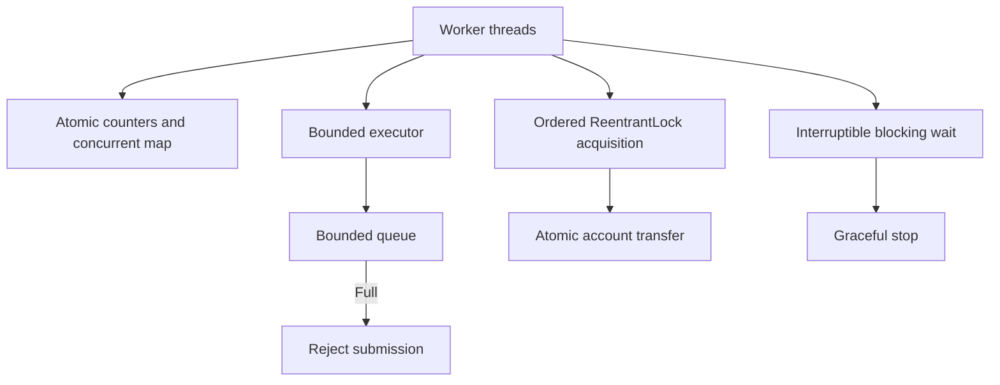

# Java Concurrency Lab

Runnable Java 17 examples for concurrency correctness, contention and coordination, with JUnit 5 tests and GitHub Actions CI.

## Run

```bash
mvn -B clean verify
```

## Topics and examples

- `SafeCounter`: `AtomicLong` versus `LongAdder` under contention; snapshots after joining workers.
- `ConcurrentWordCounter`: concurrent map and atomic per-key frequency updates.
- `VolatileStopFlag`: visibility and cooperative stop signal.
- `BoundedTaskExecutor`: bounded queue, fixed-size worker pool, rejection under saturation, orderly shutdown.
- `InterruptibleWorker`: interruptible blocking queue consumer and restoration of interrupt status.
- `LockProtectedTransfer`: consistent lock ordering prevents opposite-direction transfer deadlocks; account balances protected by locks.

## Design and tradeoffs



`volatile` guarantees visibility, not atomic read-modify-write. `AtomicLong` is suitable for exact atomic updates, whereas `LongAdder` reduces contention but its `sum()` is not an atomic snapshot during concurrent writes. Bounded queues make overload explicit rather than accumulating unbounded work. Interruption is cooperative: blocked operations should propagate or restore the interrupt signal. Lock ordering avoids circular wait, provided account identifiers are unique.

## Interview exercises

1. Explain why `volatile int count; count++` is not atomic.
2. Compare `AtomicLong` and `LongAdder` under contention.
3. Explain why unbounded executor queues can hide overload.
4. Explain how ordered lock acquisition avoids deadlocks.
5. Describe correct handling of `InterruptedException` and thread cancellation.

Tests assert deterministic invariants and use bounded waits; scheduling and throughput are environment-dependent. These examples teach core mechanisms rather than benchmark throughput.


## Step-by-step quickstart and result verification

**Environment:** JDK **17 or newer** (17 is the CI target), Maven **3.9+**, Git, an internet connection for the first Maven dependency download, and a terminal (PowerShell, Command Prompt, bash, or zsh). **No Docker, database, Kafka, Spring Boot server, or open network ports are required.**

1. Check prerequisites:
   ```bash
   java -version
   mvn -version
   git --version
   ```
   Ensure Maven reports a Java 17+ runtime.
2. Download the repository and enter it:
   ```bash
   git clone https://github.com/rocky-bgta/java-concurrency-lab.git
   cd java-concurrency-lab
   ```
3. Compile and execute **all** concurrency exercises via JUnit tests:
   ```bash
   mvn -B clean verify
   ```
   **Expected result:** `BUILD SUCCESS` and zero test failures. The tests themselves are the runnable entry points; there is **no application `main()` or web endpoint**.
4. To inspect individual behavior, run one named test class:
   ```bash
   mvn -Dtest=SafeCounterTest test
   mvn -Dtest=BoundedTaskExecutorTest test
   mvn -Dtest=LockProtectedTransferTest test
   ```
   The remaining classes are `ConcurrentWordCounterTest`, `VolatileStopFlagTest` and `InterruptibleWorkerTest`. Tests cover correctness, safe shutdown, rejection on a full executor, and deadlock avoidance.
5. Read the detailed local results in `target/surefire-reports/` (text and XML). Compare the output with the repository's GitHub Actions **Java CI** workflow, which runs `mvn -B verify` on Java 17.

**Troubleshooting:** If `mvn` is not recognized, install Maven and add its `bin` directory to `PATH`; set `JAVA_HOME` to a JDK 17+ installation. Thread scheduling varies between machines, so execution order and elapsed time are **not** deterministic and should not be interpreted as benchmark results.
